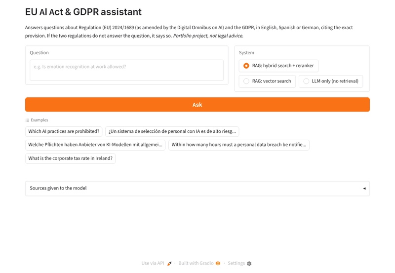
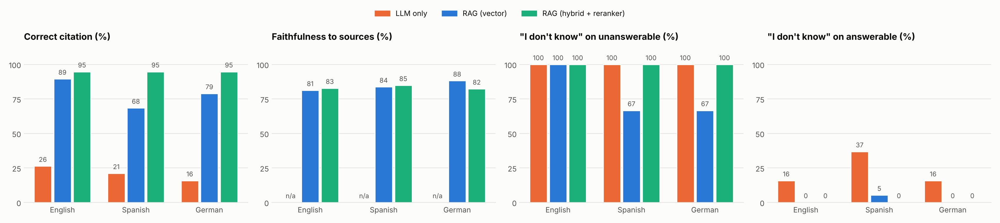
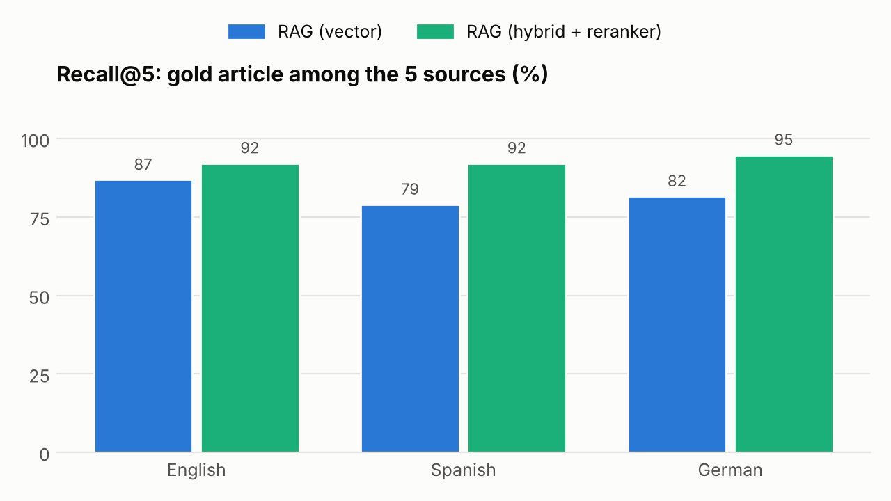

# EU AI Act & GDPR Assistant

A retrieval-augmented assistant that answers questions about the EU AI Act
(Regulation (EU) 2024/1689, as amended by the Digital Omnibus on AI) and the
GDPR (Regulation (EU) 2016/679), citing the exact article, annex or recital
behind each answer, and an evaluation that measures how well it works in
English, Spanish and German.




*Demo recorded on a CPU with the same model in 4-bit GGUF (llama.cpp); waiting
time is cut.*

## Results

50 questions with their gold articles ([eval/questions.json](eval/questions.json)):
27 direct, 13 that need several articles and 10 that the two regulations do not
answer. 22 of them were also asked in Spanish and German. The LLM is
Qwen2.5-7B-Instruct (AWQ, served with vLLM on a Colab T4); the language
comparison uses the same 22 questions in every language.



| English, 50 questions | LLM only | RAG (vector) | RAG (hybrid + reranker) |
|---|---:|---:|---:|
| Recall@5 (gold article in the 5 sources) | – | 90.0 | **92.5** |
| Correct citation | 27.5 | 92.5 | **92.5** |
| Citation precision | 26.6 | 62.0 | **63.5** |
| Faithfulness to sources (LLM judge) | – | 84.0 | **86.1** |
| "I don't know" on unanswerable questions | 100 | 90 | 90 |
| "I don't know" on answerable questions (lower is better) | 20.0 | 0 | 0 |

| Correct citation, same 22 questions | English | Spanish | German |
|---|---:|---:|---:|
| LLM only | 26.3 | 21.1 | 15.8 |
| RAG (vector) | 89.5 | 68.4 | 78.9 |
| RAG (hybrid + reranker) | **94.7** | **94.7** | **94.7** |

What the numbers say:

- **Without retrieval the model cannot cite.** It names the right article in
  about one answer in four, and it avoids answering a fifth of the questions it
  could answer (a third in Spanish).
- **Vector search alone degrades outside English** (89.5 → 68.4 correct
  citations in Spanish). Hybrid search with a reranker keeps all three
  languages at 94.7.
- **The reranker is what makes hybrid search work.** BM25 + vectors without
  the reranker retrieves *worse* than vectors alone (Recall@5 87.5 vs 90.0 in
  English, 73.7 vs 81.6 in German); with the reranker it is best everywhere.



Details: [results/summary.md](results/summary.md); every answer, its sources
and the judge's verdict are in `results/answers.jsonl` and
`results/judgements.jsonl`.

**Limitations.** Gold labels are at article level, so an answer that cites the
right article but the wrong paragraph counts as correct. Citation precision is
strict: citing a relevant recital next to the gold article lowers it.
Faithfulness is judged by the same 7B model that answers. The translated set
has only 19 answerable and 3 unanswerable questions, so a single question moves
the Spanish and German abstention rates by 33 points.

## Run it

```bash
pip install -r requirements.txt
python -m ingest.download   # official texts from EUR-Lex + version check
python -m ingest.parse      # article/paragraph chunks with metadata
python -m ingest.embed      # bge-m3 embeddings (a few minutes on GPU, ~25 on CPU)
pytest
```

**On a GPU (Google Colab).** [notebooks/colab_rag.ipynb](notebooks/colab_rag.ipynb)
builds the index, serves Qwen2.5-7B-Instruct with vLLM on a free T4, runs the
whole evaluation (`python -m eval.run_eval --stage all`) and starts the demo
with a public link.

**On a laptop (CPU).** Serve the same model in 4-bit with llama.cpp's
OpenAI-compatible server and point the app to it:

```bash
pip install "llama-cpp-python[server]"
hf download Qwen/Qwen2.5-7B-Instruct-GGUF --include "*q4_k_m*" --local-dir models
python -m llama_cpp.server --model models/qwen2.5-7b-instruct-q4_k_m-00001-of-00002.gguf \
    --model_alias qwen --n_ctx 6144 --port 8000
export LLM_BASE_URL=http://localhost:8000/v1 LLM_MODEL=qwen
python app.py                                   # Gradio demo on http://localhost:7860
python -m rag.pipeline "¿Qué dice el artículo 22 del RGPD?"
python -m rag.pipeline "Was regelt Anhang III?" --retrieve-only   # no LLM needed
```

Answers take a few minutes each on a CPU; retrieval alone (and
`python -m eval.run_eval --stage retrieval`) runs fine without a GPU.

## How it works

1. **Chunking by legal unit.** Articles are split by paragraph, long paragraphs
   by point, annexes by top-level point, and each recital is one chunk. Every
   chunk carries law, article, paragraph, title, chapter and section.
2. **Hybrid retrieval.** bge-m3 dense vectors (FAISS) and BM25 are merged with
   Reciprocal Rank Fusion. BM25 also indexes reference tokens, so "Article 6",
   "artículo 22 del RGPD" or "Anhang III" match exactly; articles named in the
   question are always kept among the sources.
3. **Reranking.** bge-reranker-v2-m3 re-scores the 30 fused candidates; recitals
   are slightly discounted so operative articles come first.
4. **Small-to-big context.** Chunks that are points of the same paragraph are
   merged back into the full paragraph before reaching the model.
5. **Cited answers.** The model (Qwen2.5-7B-Instruct served with vLLM) answers
   only from numbered sources, cites them as [n] (mapped back to "AI Act,
   Article 5(1)") and answers `NO_ANSWER` when the sources do not cover the
   question.

Three systems are compared in the evaluation: `llm_only` (no retrieval),
`dense` (vector search) and `hybrid_rerank`.

## Repository layout

```
data/      raw EUR-Lex XHTML (git-ignored), processed chunks, embeddings
ingest/    download, article-level parsing, embeddings
rag/       references, retrieval, context building, generation, pipeline
eval/      questions.json, run_eval.py (metrics), charts.py
results/   answers, judgements, tables and charts
notebooks/ Colab notebook (vLLM, evaluation, demo)
tests/     unit tests
app.py     Gradio demo
```

## Data and versions

The texts are the official EUR-Lex publications, downloaded in English, Spanish
and German. The AI Act is indexed in its consolidated version of 27 July 2026,
which includes the Digital Omnibus on AI (Regulation (EU) 2026/1744); recitals
come from the original Official Journal text. The download script checks EUR-Lex
for newer consolidations and amending acts. Details in
[docs/data_sources.md](docs/data_sources.md).

## License

MIT for the code. The legal texts are © European Union, reused under the
Commission's reuse policy (Decision 2011/833/EU).

*This is a portfolio project, not legal advice.*
